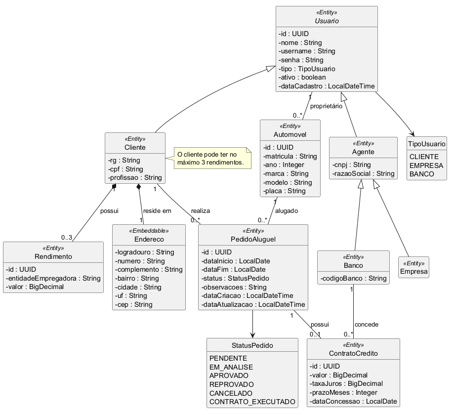

# AlugaCar - Sistema de Aluguel de Carros

Sistema web para apoio à gestão de aluguéis de automóveis. Clientes criam, modificam, consultam e cancelam pedidos de aluguel pela Internet; agentes (empresas e bancos) avaliam financeiramente os pedidos e, quando há financiamento, o banco concede um contrato de crédito.

> Engenharia de Software - PUC Minas - Prof. João Paulo Carneiro Aramuni

## Aluno
| Sophia Ferreira | [2º período] |

## Tecnologias

| Camada | Tecnologia |
|---|---|
| Linguagem | Java (JDK 25) |
| Back-end | Spring Boot 4.0.x, arquitetura MVC, Spring Data JPA, Spring Security + JWT |
| Build e dependências | Apache Maven (Maven Wrapper incluído) |
| Front-end | React 19 + Vite 7 + React Router 7 |
| Banco de dados | Supabase (PostgreSQL) |
| Autenticação | Login obrigatório com usuário e senha (BCrypt) e token JWT |
| Testes | JUnit 5, MockMvc e H2 em memória |

O Supabase é usado **apenas como banco PostgreSQL**; a autenticação é feita inteiramente no Spring Security.

## Funcionalidades

| ID | Funcionalidade | Perfil |
|---|---|---|
| US01 | Cadastro de cliente, empresa e banco | Visitante |
| US02 | Login com token JWT | Todos |
| US03 | Perfil do cliente (nome, profissão, endereço) | Cliente |
| US04 | Rendimentos do cliente (máximo de 3) | Cliente |
| US05 | Automóveis (cadastro e manutenção dos próprios) | Cliente, empresa e banco |
| US06 | Criar e alterar pedido de aluguel | Cliente |
| US07 | Cancelar pedido | Cliente |
| US08 | Avaliar pedido e registrar o parecer | Empresa e banco |
| US09 | Conceder contrato de crédito | Banco |
| US10 | Isolamento dos pedidos por cliente | Cliente |

Critérios de aceite em [`docs/uml/historias-de-usuario.md`](docs/uml/historias-de-usuario.md).

### Perfis e permissões

| Perfil (tipo) | Papéis no Spring Security | Pode |
|---|---|---|
| `CLIENTE` | `ROLE_CLIENTE` | Perfil, rendimentos, automóveis próprios, criar/alterar/cancelar/consultar os próprios pedidos |
| `EMPRESA` | `ROLE_AGENTE` | Listar e avaliar todos os pedidos, automóveis próprios |
| `BANCO` | `ROLE_AGENTE` e `ROLE_BANCO` | Tudo que a empresa pode, mais conceder contrato de crédito |

## Modelagem

| Diagrama | Arquivo |
|---|---|
| Casos de uso | [`docs/uml/casos-de-uso.png`](docs/uml/casos-de-uso.png) |
| Histórias de usuário | [`docs/uml/historias_de_usuario.png`](docs/uml/historias_de_usuario.png) |
| Classes | [`docs/uml/diagrama-classes.png`](docs/uml/diagrama-classes.png) |
| Pacotes (visão lógica) | [`docs/uml/diagrama-pacotes.png`](docs/uml/diagrama-pacotes.png) |

Os diagramas têm o código-fonte PlantUML (`.puml`) na mesma pasta.



Arquitetura, regras de negócio e alinhamento entre modelo e código em [`docs/arquitetura.md`](docs/arquitetura.md).

## Estrutura do repositório

```text
.
├── backend/                         # Spring Boot (Maven)
│   ├── src/main/java/com/lab/alugacar/
│   │   ├── controller/  service/  repository/  model/
│   │   ├── dto/  security/  exception/  config/
│   ├── src/main/resources/application.properties
│   ├── src/test/java/com/lab/alugacar/    # testes
│   ├── src/test/resources/application-test.properties
│   └── .env.example
├── frontend/                        # React + Vite
│   └── src/ (pages, components, api.js, auth.jsx)
├── docs/
│   ├── arquitetura.md   api.md   apresentacao.md
│   ├── sql/schema.sql
│   └── uml/
└── README.md
```

## Como executar

### Pré-requisitos

- JDK 25
- Node.js 20 ou superior e npm
- Projeto criado no Supabase (PostgreSQL)

### 1. Banco de dados

1. No Supabase, abra o **SQL Editor** e execute o conteúdo de [`docs/sql/schema.sql`](docs/sql/schema.sql).
2. Em **Project Settings > Database**, copie os dados de conexão. Se a conexão direta falhar (ela pode exigir IPv6), use a string do **Session pooler**.

O back-end usa `spring.jpa.hibernate.ddl-auto=validate`: ele **não cria tabelas**, apenas confere se o schema bate com as entidades.

### 2. Back-end

```bash
cd backend
cp .env.example .env     # preencha com os seus dados (o .env não é versionado)
```

| Variável | Descrição |
|---|---|
| `DB_URL` | URL JDBC do Supabase, por exemplo `jdbc:postgresql://HOST:5432/postgres` |
| `DB_USERNAME` | Usuário do banco |
| `DB_PASSWORD` | Senha do banco |
| `JWT_SECRET` | Chave **Base64 com pelo menos 32 bytes**. Gere com `openssl rand -base64 32` |
| `JWT_EXPIRATION` | Validade do token em milissegundos (padrão: `86400000`, 24 horas) |
| `CORS_ALLOWED_ORIGINS` | Origens permitidas, separadas por vírgula (padrão: `http://localhost:5173`) |

O Spring Boot **não lê o arquivo `.env` sozinho**: as variáveis precisam estar no ambiente do processo.

Linux/macOS (o `.env` precisa ter finais de linha LF):

```bash
set -a; source .env; set +a
./mvnw spring-boot:run
```

Windows (PowerShell):

```powershell
Get-Content .env | Where-Object { $_ -match '^\s*[^#=\s]+=' } | ForEach-Object {
  $k, $v = $_ -split '=', 2
  [Environment]::SetEnvironmentVariable($k.Trim(), $v.Trim(), 'Process')
}
.\mvnw.cmd spring-boot:run
```

Também funciona definir as variáveis na configuração de execução da IDE. A API sobe em `http://localhost:8080`.

### 3. Front-end

```bash
cd frontend
cp .env.example .env     # VITE_API_URL=http://localhost:8080/api
npm install
npm run dev
```

A aplicação abre em `http://localhost:5173`.

### 4. Testes

```bash
cd backend
./mvnw test
```

Os testes usam o perfil `test` (H2 em memória) e **não** precisam do Supabase nem de variáveis de ambiente. Cobrem o fluxo completo de aluguel e as regras de negócio e de permissão (rendimentos, isolamento por cliente, transições de status, contrato de crédito).

## Documentação da API

Rotas, perfis, exemplos e códigos de resposta em [`docs/api.md`](docs/api.md).

## Fluxo principal de uso

1. O visitante se cadastra como cliente, empresa ou banco e faz login.
2. O cliente cadastra (ou escolhe) um automóvel e cria um pedido de aluguel, que nasce `PENDENTE`.
3. O agente inicia a análise (`EM_ANALISE`) e emite o parecer (`APROVADO` ou `REPROVADO`).
4. Se aprovado, o banco pode conceder um contrato de crédito e o pedido passa a `CONTRATO_EXECUTADO`.
5. O cliente acompanha o status e pode cancelar enquanto o pedido não estiver `REPROVADO`, `CANCELADO` ou `CONTRATO_EXECUTADO`.

## Segurança

- Senhas guardadas com BCrypt; a API nunca devolve a senha.
- Sessão stateless com JWT assinado (HS256); CSRF desabilitado por não usar cookies.
- Credenciais e a chave do JWT ficam em variáveis de ambiente. O `.env` está no `.gitignore`.
- Nas tabelas do Supabase, o RLS está habilitado e sem políticas, o que bloqueia o acesso direto pela API pública (PostgREST). O back-end acessa o banco por JDBC com o usuário do banco.
