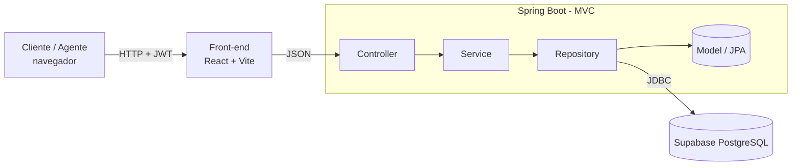
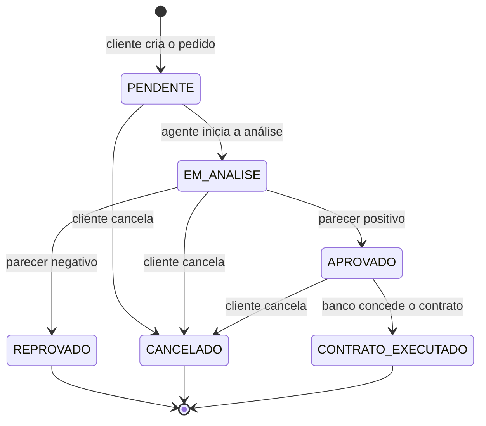

# Arquitetura e Regras de Negócio

## 1. Visão geral

O front-end (React + Vite) conversa com o servidor central (Spring Boot) por HTTP/JSON. O servidor persiste os dados no PostgreSQL do Supabase por JDBC.

O enunciado divide o sistema em dois subsistemas:

| Subsistema | Onde está |
|---|---|
| Gestão de pedidos e contratos | Back-end (`controller`, `service`, `repository`, `model`) |
| Construção dinâmica das páginas web | Front-end React (`pages`, `components`) |

## 2. Camadas e dependências reais entre pacotes

Pacote base: `com.lab.alugacar`. O quadro abaixo foi extraído dos `import` do código e é o que o [diagrama de pacotes](uml/diagrama-pacotes.png) representa.

| Pacote | Papel | Depende de |
|---|---|---|
| `controller` | Recebe as requisições HTTP e devolve respostas | `service`, `dto` |
| `service` | Regras de negócio | `repository`, `model`, `dto`, `exception`, `security` |
| `repository` | Acesso a dados (Spring Data JPA) | `model` |
| `model` | Entidades JPA e enums | (nenhum) |
| `dto` | Objetos de entrada e saída da API e o `DtoMapper` | `model` |
| `security` | JWT, filtro de autenticação, `UserDetailsService`, `SecurityConfig` | `repository`, `model` |
| `exception` | Exceções de negócio e tratamento global (`@RestControllerAdvice`) | (nenhum) |
| `config` | Reservado para configurações (hoje vazio) | (nenhum) |

`service -> security` existe porque o `AuthService` usa o `JwtService` e o `CustomUserDetailsService` para fazer o login. `model` não depende de nenhum outro pacote.

## 3. Modelo de domínio

Ver [`uml/diagrama-classes.png`](uml/diagrama-classes.png).

| Classe do modelo | Código | Observação |
|---|---|---|
| `Usuario` (abstrata) | `model.Usuario` | Herança JOINED; `tipo` é a coluna discriminadora e `getTipo()` é abstrato |
| `Cliente` | `model.Cliente` | RG, CPF, `Endereco` embutido, profissão; até 3 `Rendimento` |
| `Agente` (abstrata) | `model.Agente` | CNPJ e razão social |
| `Empresa`, `Banco` | `model.Empresa`, `model.Banco` | `Banco` tem `codigoBanco` |
| `Endereco` | `model.Endereco` (`@Embeddable`) | Logradouro, número, complemento, bairro, cidade, UF e CEP |
| `Rendimento` | `model.Rendimento` | Entidade empregadora e valor |
| `Automovel` | `model.Automovel` | O proprietário é um `Usuario` (cliente, empresa ou banco) |
| `PedidoAluguel` | `model.PedidoAluguel` | Status, datas, observações, contrato (0..1) |
| `ContratoCredito` | `model.ContratoCredito` | Valor, taxa de juros, prazo em meses, banco concedente |
| `TipoUsuario`, `StatusPedido` | enums em `model` | Ver seção 4 |

O schema do banco está em [`sql/schema.sql`](sql/schema.sql) e é compatível com `ddl-auto=validate`.

## 4. Ciclo de vida do pedido

## 5. Regras de negócio e onde são aplicadas

| ID | Regra | Onde |
|---|---|---|
| RN01 | Só usuários cadastrados e autenticados usam o sistema | `SecurityConfig` (`anyRequest().authenticated()`) e filtro JWT |
| RN02 | Username único; senha com BCrypt (6 a 100 caracteres) | `AuthService`, DTO e restrição `unique` no banco |
| RN03 | Cliente tem no máximo 3 rendimentos | `RendimentoService`, `@Size` no DTO de cadastro e na entidade |
| RN04 | Cliente só vê, altera e cancela os próprios pedidos (403 nos demais) | `PedidoService.validarClienteDoPedido` |
| RN05 | Empresa e banco avaliam pedidos; só o banco concede contrato | `@PreAuthorize` nos controllers e `CurrentUserService` |
| RN06 | Pedido nasce `PENDENTE`; `dataFim` não pode ser anterior a `dataInicio` | `PedidoService` e `check` no banco |
| RN07 | Pedido só pode ser alterado em `PENDENTE` ou `EM_ANALISE` | `PedidoService.atualizar` |
| RN08 | Não se cancela pedido `REPROVADO`, `CANCELADO` ou `CONTRATO_EXECUTADO` | `PedidoService.cancelar` |
| RN09 | Transições do agente: `PENDENTE -> EM_ANALISE -> APROVADO` ou `REPROVADO` | `PedidoService.avaliar` |
| RN10 | Contrato só em pedido `APROVADO`, no máximo um por pedido; o pedido vira `CONTRATO_EXECUTADO` | `ContratoService` e `unique` em `pedido_id` |
| RN11 | Só o proprietário altera ou remove um automóvel; com pedidos, não pode ser removido | `AutomovelService` |
| RN12 | Matrícula e placa de automóvel são únicas | `AutomovelService` e `unique` no banco |

## 6. Rastreabilidade: história de usuário, API e tela

| US | Endpoints (detalhes em [`api.md`](api.md)) | Tela |
|---|---|---|
| US01 | `POST /api/auth/register/{cliente,empresa,banco}` | Cadastro |
| US02 | `POST /api/auth/login` | Login |
| US03 | `GET`, `PUT /api/perfil` | Meu perfil |
| US04 | `/api/rendimentos` | Meu perfil (rendimentos) |
| US05 | `/api/automoveis`, `/api/automoveis/meus` | Automóveis |
| US06 | `POST /api/pedidos`, `PUT /api/pedidos/{id}` | Pedidos |
| US07 | `PATCH /api/pedidos/{id}/cancelar` | Pedidos |
| US08 | `GET /api/pedidos`, `PATCH /api/pedidos/{id}/status` | Pedidos (visão do agente) |
| US09 | `POST /api/contratos` | Pedidos (visão do banco) |
| US10 | `GET /api/pedidos/meus`, `GET /api/pedidos/{id}` | Pedidos |

## 7. Evolução do modelo (revisão dos diagramas)

Principais mudanças da primeira versão da modelagem para a final:

| Ponto | Versão inicial | Versão final |
|---|---|---|
| Identificadores | `Long` | `UUID` |
| Usuário | `login`, `senhaHash` | `username`, `senha`, `tipo`, `ativo`, `dataCadastro` |
| Endereço | `String` simples | Classe `Endereco` embutida em `Cliente` |
| Pedido | `dataPedido` e `parecer` | `dataInicio`, `dataFim`, `observacoes`, `dataCriacao`, `dataAtualizacao` |
| Pedido x Automóvel | `*` pedidos para `1` automóvel | `Automovel 1 ── 0..* PedidoAluguel` |
| Agente | `nome`, `cnpj` | `cnpj`, `razaoSocial` |
| Contrato de crédito | `valor`, `parcelas` | `valor`, `taxaJuros`, `prazoMeses`, `dataConcessao` |

Ajustes feitos na revisão final, ao comparar os diagramas com o código:

| Diagrama | Ajuste |
|---|---|
| Pacotes | A seta entre `service` e `security` estava invertida; incluída a dependência `dto -> model`; `config` passou a constar como vazio |
| Casos de uso | "Gerenciar automóveis" passou a incluir o cliente, que cadastra os próprios automóveis |

## 8. Limitações conhecidas e melhorias futuras

| Ponto | Situação atual | Melhoria possível |
|---|---|---|
| Sobreposição de datas | Um mesmo automóvel pode ter vários pedidos ativos com períodos que se sobrepõem | Consulta de sobreposição no `PedidoService.criar` (resposta 409) |
| RG e CPF | Validados só por tamanho; o CPF é único, mas sem conferência de dígitos | Validação do dígito verificador |
| Cancelamento | Pedido `APROVADO` ainda pode ser cancelado pelo cliente | Restringir a `PENDENTE` e `EM_ANALISE` |
| Contrato | Só existe a execução via contrato de crédito; não há "executar" um pedido aprovado sem financiamento | Endpoint de execução pelo agente |
| Formato de erro | Erros das regras usam `ProblemDetail`; 401 e 403 do filtro de segurança usam outro JSON | Unificar os formatos |
| Dependências | `spring-boot-starter-oauth2-resource-server` está no `pom.xml`, mas o JWT é feito com `jjwt` | Remover a dependência não usada |
